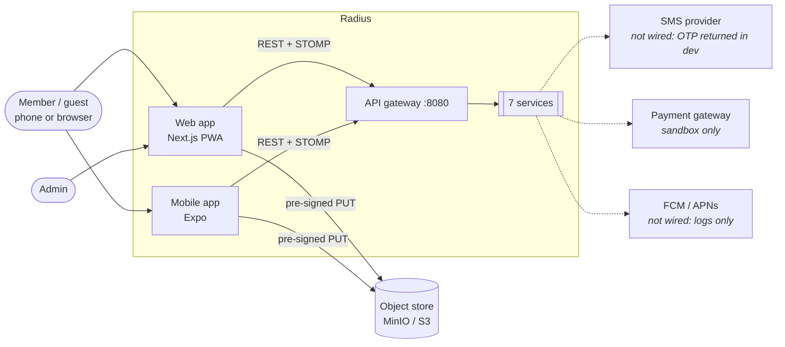
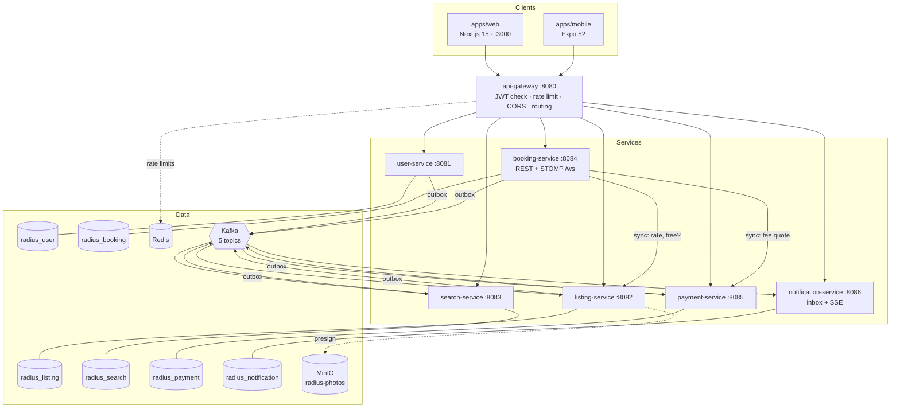
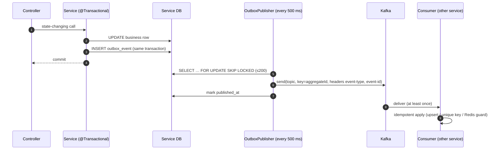
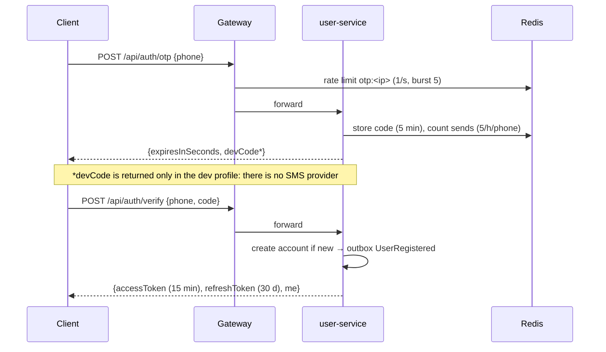
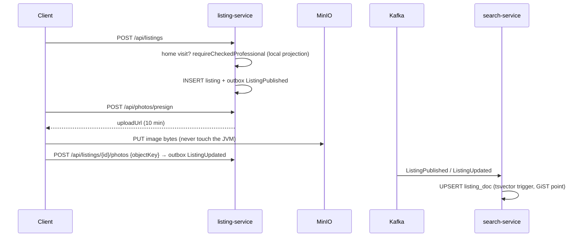
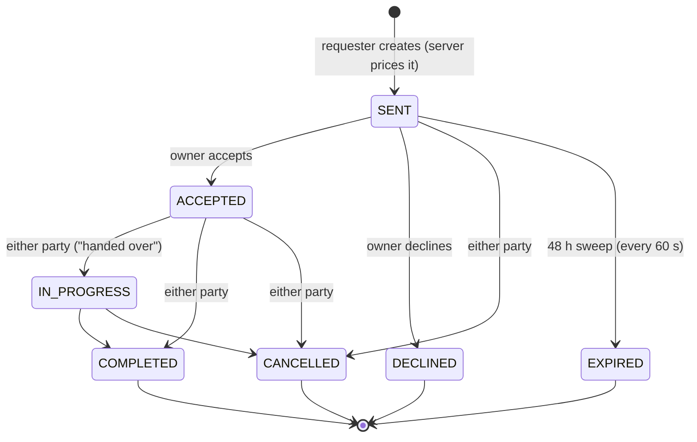
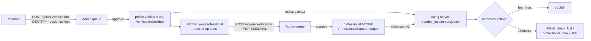
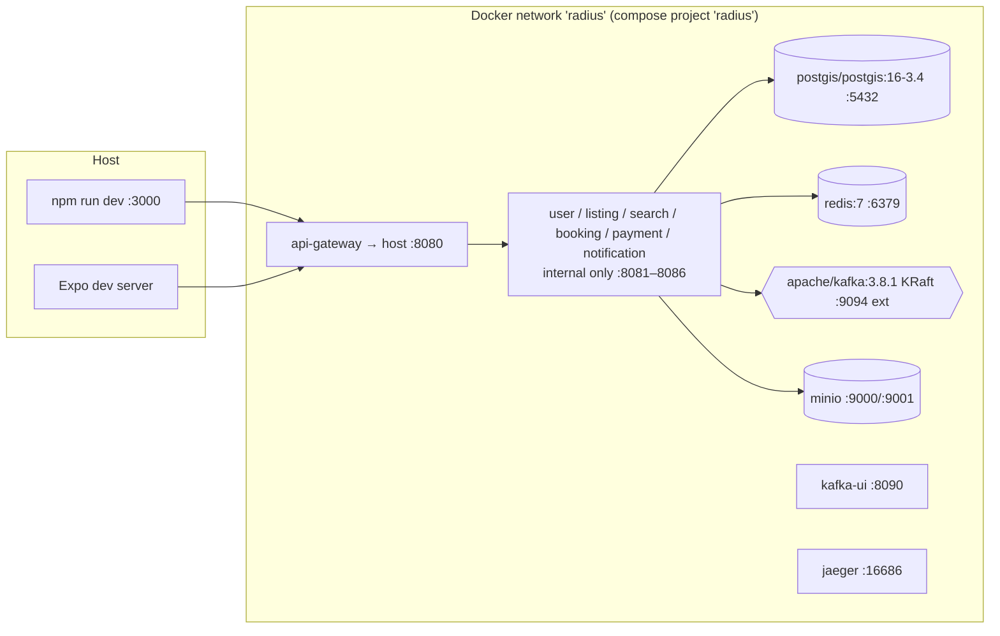

# 02 · Architecture

> **Audience:** developers, tech lead.
> **Read first:** [01 · Product vision](01-product-vision.md).
> **Deep dives:** [05 · Data model](05-data-model.md), [06 · API](06-api-reference.md),
> [07 · Events](07-events-and-messaging.md), [14 · Decisions](14-decision-log.md).

## 1. Shape in one paragraph

Radius is a set of **seven Spring Boot services** (Java 21) behind one **Spring Cloud Gateway**.
Each service **owns its own PostgreSQL database**. Services tell each other about changes with
**Kafka events written through a transactional outbox**, and make a **synchronous HTTP call
only where a stale answer would be wrong** (price and fee). Search is a separate **CQRS read
model** built entirely from events. Two clients, a **Next.js 15** web app and an **Expo / React
Native** mobile app, call only the gateway. Redis holds rate-limit buckets, OTP codes and
idempotency keys. MinIO (S3-compatible) holds photos, which browsers upload directly with
pre-signed URLs.

## 2. System context



External providers (SMS, push, payment gateway, ID-check provider) **are not connected**. Each
one sits behind an interface or a sandbox so it can be swapped in later. See
[§9 What is simulated](#9-what-is-simulated-and-where-the-seams-are).

## 3. Containers



All six databases live in **one PostgreSQL 16 + PostGIS instance** locally. They are separate
databases, so no service can join across them. See [05](05-data-model.md).

## 4. Service catalogue

| Service | Port | Owns (source of truth for) | Publishes | Consumes | Sync calls out |
| --- | --- | --- | --- | --- | --- |
| **api-gateway** | 8080 | Nothing. Stateless edge | — | — | Every service (routing) |
| **user-service** | 8081 | Accounts, phone OTP, refresh tokens, profiles + home point, tag vocabulary, ID/professional checks, professional profiles, roles | `radius.user.v1`, `radius.notification.v1` | — | — |
| **listing-service** | 8082 | Listings (7 kinds), photos, weekly availability, calendar blocks, nearby feed, comments, ratings, reports, comment bans | `radius.listing.v1` | `radius.user.v1`, `radius.request.v1` | MinIO (presign) |
| **search-service** | 8083 | **Nothing authoritative.** A rebuildable read model of listings + members, saved searches, the sentence parser, the map | `radius.notification.v1` (digest) | `radius.listing.v1`, `radius.user.v1` | — |
| **booking-service** | 8084 | Booking requests and their state machine, transition audit, chat messages, price breakdown | `radius.request.v1`, `radius.notification.v1` | — | listing-service (`/internal/listings`), payment-service (`/internal/fees`) |
| **payment-service** | 8085 | Fee config, payments, deposit holds, payouts, gateway webhook log | `radius.payment.v1` | `radius.request.v1` | — |
| **notification-service** | 8086 | Inbox, device tokens, delivery channels, SSE stream | — | `radius.notification.v1`, `radius.user.v1` | — |

There is also **`services/common`**, a library (not a service). It auto-configures JWT handling,
the outbox, the idempotency guard, the error format, `Geo` (privacy rounding) and `Cursor`
(keyset paging) into every service.

### Inside a service

Every service has the same package layout (`io.radius.<svc>`):

```
api/        Controllers (thin) + Dtos.java (request/response records). Never return entities.
domain/     JPA entities. Invariants and state machines live here.
repo/       Spring Data repositories + native spatial SQL (FeedQuery, SearchQuery, ProjectionWriter).
service/    Transactions, authorization decisions, outbox publishing.
messaging/  @KafkaListener consumers.
client/     Sync HTTP clients (booking only), behind resilience4j.
config/     Spring config (persistence, S3, WebSocket, admin bootstrap).
```

## 5. How services talk

### 5.1 Events (the default)



- **Never** call `KafkaTemplate` from business code. Writing the row and the event in one
  transaction closes the gap where *"the event fired but the row rolled back"*.
- Delivery is **at least once**, so every consumer must be idempotent. Each one uses the
  cheapest mechanism that is correct for it. See [07](07-events-and-messaging.md#4-consumers).
- Topics are versioned (`.v1`). Changes to event records are **additive only**. A breaking change
  gets a `.v2` topic.

### 5.2 Synchronous calls (only where stale = wrong)

| Caller → callee | Why it must be synchronous | Failure behaviour |
| --- | --- | --- |
| booking → listing `GET /internal/listings/{id}` | The **rate** used to price a booking must be the current one | **No fallback.** A guess about money is worse than an error, so the caller gets an error |
| booking → listing `GET /internal/listings/{id}/free` | Pre-check for date clashes | Falls back to "free". booking's own DB overlap check is the real guard |
| booking → payment `GET /internal/fees/quote` | The fee shown must be the fee charged | Falls back to **fee = 0** ("none for now") |

All three are wrapped in a resilience4j circuit breaker (`listing`, `payment`). Window 20, 50%
failure threshold, 10 s open. `/internal/**` is **not routed by the gateway**; it is reachable
only on the internal network.

## 6. Key flows

### 6.1 Sign in (phone OTP)



On any **401**, both clients call `POST /api/auth/refresh` **once**, shared across all in-flight
requests, then retry. A refresh token that has already been used **revokes the whole family**.
That is treated as a leak, not a retry.

### 6.2 Publish a listing → it becomes searchable



### 6.3 Booking lifecycle



What each transition sets off across the system:

| Transition | Event | Who reacts |
| --- | --- | --- |
| → SENT | `RequestCreated` + `NotificationRequested(request_received)` | notification (owner's inbox) |
| → ACCEPTED | `RequestAccepted` | **listing**: blocks the dates on the calendar. **payment**: opens a payment and a deposit hold |
| → COMPLETED | `RequestCompleted` | **listing**: records `completed_booking` (enables the "verified booking" rating badge). **payment**: releases the deposit |
| → CANCELLED | `RequestCancelled` | **payment**: releases the deposit. ⚠ listing does **not** unblock the dates. See [13](13-known-issues.md) |
| → DECLINED / EXPIRED | notification only | notification |

Only `RequestService` drives transitions, only through `BookingRequest.transitionTo`, and every
transition writes a `request_transition` audit row.

### 6.4 Trust gates for home visits



listing-service decides *"may this person publish a home visit?"* from its **own projection**.
It never calls user-service. A refusal **must** carry a reason (`reason_required`).

### 6.5 Search ("ask" mode)

1. `POST /api/search {q: "I need someone who knows video editing within 5 km"}`.
2. `QueryParser` (rules): synonym dictionary over the tag vocabulary → `tags`; regex
   `within N km|m|min` → `radiusKm`; day words → `day`; verbs → `kinds`.
3. If the rules extract nothing, a Redis cache is checked and then `LlmFallback` is tried.
   **It is disabled**, so the query is just logged as a candidate synonym.
4. `SearchQuery` runs `ST_DWithin` + full-text (`search_vector`) + tag overlap against
   `listing_doc` and `member_doc`, sorted by relevance, distance, price or rating.
5. The response echoes `parsed` so the client can show **removable chips**.

## 7. Cross-cutting concerns

| Concern | How | Where |
| --- | --- | --- |
| **Authentication** | HS-JWT, 15 min access + 30 d rotating refresh. Checked at the gateway (fast path) **and** again in each service | `common/security/*`, `api-gateway/AuthenticationFilter` |
| **Authorization** | `AuthUser me` parameter. `me.requireAdmin()` **throws**. Ownership checks in the service layer | `AuthUser`, each `*Service` |
| **Guest access** | Per-service `radius.security.public-get-paths`. A handler takes `@Nullable AuthUser` | service `application.yml` |
| **Errors** | `ApiException(status, code, message)` → `{code, message, fields, path, at}` | `common/web/*` |
| **Money** | `long` minor units; fee in basis points; only `PricingService` / `FeeConfig` compute | booking, payment |
| **Distance** | PostGIS `ST_DWithin` on a GiST index; `geography` column generated from lat/lon | `FeedQuery`, `SearchQuery` |
| **Location privacy** | `Geo.roundLat/roundLon` (~100 m) on home points at write time; `Geo.coarsen(…, 250)` for guests at read time | `common/support/Geo.java` |
| **Paging** | Keyset `(distance, id)` on the feed; offset on search | `common/support/Cursor.java` |
| **Rate limiting** | Gateway Redis token bucket (20/s, burst 60; OTP 1/s, burst 5); OTP per phone; `PostingLimiter` per member by account age | gateway, `OtpService`, `PostingLimiter` |
| **Observability** | Micrometer + OTel → Jaeger (100% sampling); `/actuator/prometheus`; health probes | every service |
| **API docs** | springdoc. `/swagger-ui.html` and `/v3/api-docs` on each service port | every service |
| **Schema** | Flyway, one DB per service, `ddl-auto: validate`; applied migrations immutable | `src/main/resources/db/migration` |

Details: [12 · Security and privacy](12-security-and-privacy.md),
[11 · Configuration and operations](11-configuration-and-operations.md).

## 8. Deployment topology

### Local (the only environment that exists today)



- `docker compose --profile infra` starts only the backing services, for running the JVMs from
  an IDE or with `mvn-docker.ps1`.
- `docker compose --profile all` also builds and starts the seven services from one
  multi-stage `services/Dockerfile` (`--build-arg MODULE=…`, JRE 21 alpine, ZGC, non-root).
- A **Docker-free fallback** (`scripts/devstack.ps1` + `scripts/services.ps1`) runs portable
  binaries on ports 5433/6380/9092/9010 for locked-down Windows machines.

### Production (not built yet)

Nothing in the repo deploys to a cloud. The design assumes Kubernetes-style DNS service
discovery (`http://listing-service:8082`), so **there is no Eureka or Consul**. Before running
more than one replica of anything, read [§10](#10-scaling-limits-to-fix-before-more-than-one-replica).

## 9. What is simulated, and where the seams are

| Real-world dependency | Today | Seam to replace it |
| --- | --- | --- |
| SMS for OTP | Code returned in the response (`OTP_EXPOSE_CODE` / dev profile) and logged | `OtpService` |
| Push notifications | `LoggingPush` logs instead of sending | `NotificationService.Channel` (`Channels.java`): add FCM/APNs |
| SMS notifications | `LoggingSms`, disabled | same interface |
| Payment gateway | `gateway_ref = "sandbox_<requestId>"`; webhook endpoint real and idempotent | `PaymentService.openPayment` / `handleWebhook` |
| ID-check provider | An admin reviews uploaded evidence by hand | `VerificationService` (the build plan asks for a `VerificationProvider` interface) |
| LLM query parsing | `LlmFallback.Disabled`. ⚠ enabling it without an implementation stops the service from starting | `search/parse/LlmFallback.java` |
| Map tiles | None. `RadiusMap` is tile-free on purpose | Swap to MapLibre with the same props |

## 10. Scaling limits to fix before more than one replica

These are fine for a single-node POC and wrong for more than one replica:

| Component | Problem with more than one replica | Fix |
| --- | --- | --- |
| STOMP chat broker | In-memory: replica A's subscribers never see messages posted on replica B | Broker relay (Redis/RabbitMQ). Configuration, not code |
| SSE notification stream | Emitters held per instance in a `ConcurrentHashMap` | Fan out via Redis pub/sub, or sticky routing |
| `@Scheduled` jobs (request expiry, saved-search digest) | Run on **every** replica | ShedLock or a leader election |
| Outbox publisher | Safe (`SKIP LOCKED`), but per-key ordering is only guaranteed per replica | Acceptable, or move to Debezium CDC |
| Kafka topics | Auto-created with 1 partition | Create topics explicitly with a partition count |

## 11. Architectural qualities and how they are met

| Quality | Mechanism |
| --- | --- |
| **Correct money** | Integer minor units; server-side breakdown; fee snapshotted on the payment row; unique constraints for money idempotency |
| **Consistency across services** | Transactional outbox + idempotent consumers; sync calls only for price and fee |
| **Rebuildable search** | search-service owns no source data: drop its tables, reset its consumer groups to earliest, and it rebuilds |
| **Privacy** | Rounding at write time, coarsening for guests at read time, exact only for business addresses |
| **Safety of strangers at the door** | Two ordered human checks before a home-visit listing; refusals carry reasons; evidence purged after 30 days |
| **Simplicity** | No service discovery server, no Elasticsearch, no service mesh, no GraphQL. Each is deliberately declined in `poc.md` |
| **Changeability** | One package shape per service; shared concerns in `common` auto-config; contracts in one `RadiusEvents.java` |
