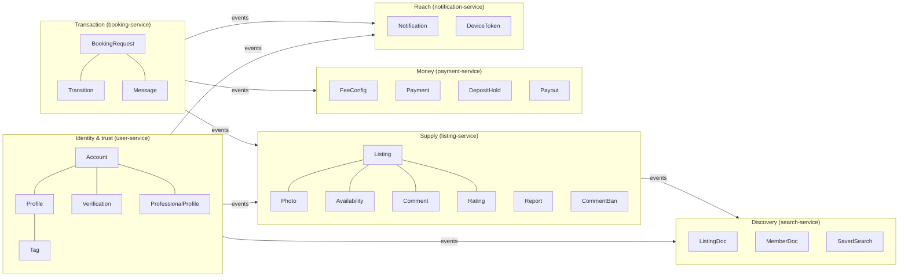
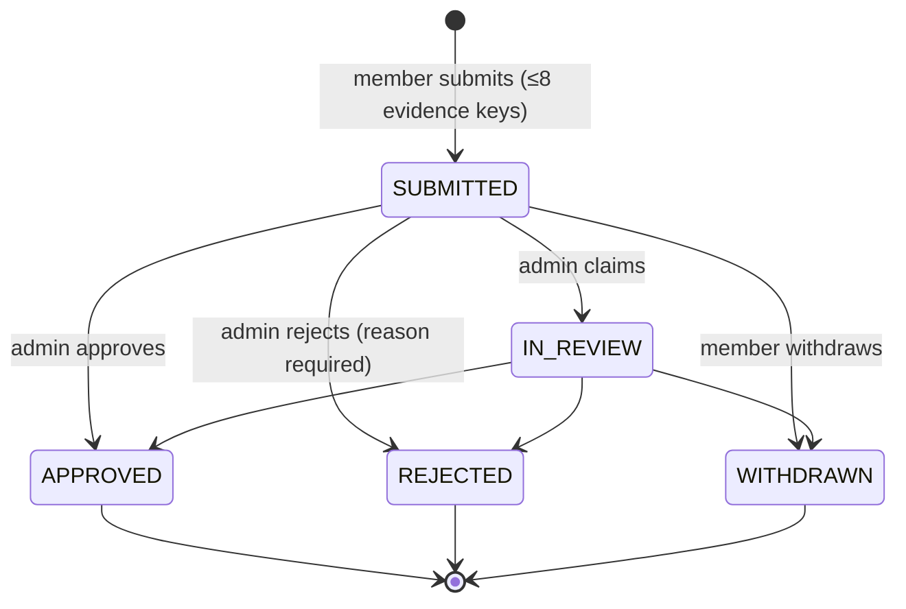
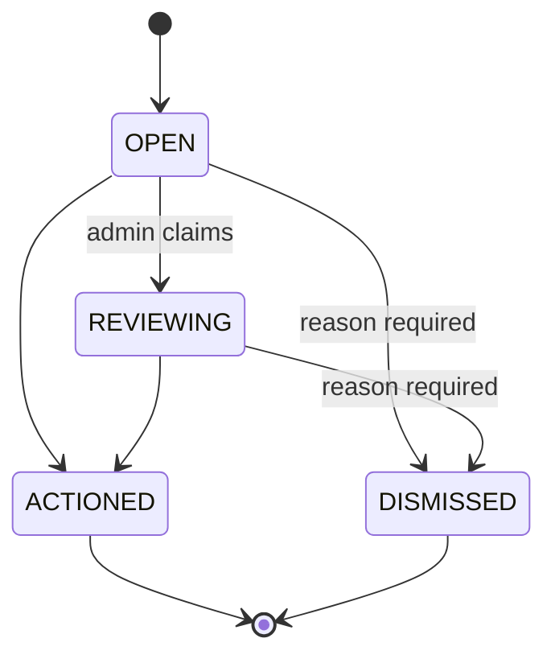

# 04 · Domain model and business rules

> **Audience:** developers and product. This is the rulebook: what the entities are, what states
> they move through, and which limits and invariants the code enforces.
> Tables and columns: [05 · Data model](05-data-model.md). Endpoints: [06 · API](06-api-reference.md).

## 1. Bounded contexts



A **member** is one account. There is no separate owner, provider or customer entity. The same
member lists and requests.

## 2. Identity and profile (user-service)

| Concept | Rules |
| --- | --- |
| **Account** | Identified by phone (unique) or email (unique). At least one is required (`app_user_contactable`). Status `ACTIVE`, `SUSPENDED` or `DELETED`; non-active accounts cannot sign in (403). Email and password columns exist but are **unused** (Block C). |
| **Role** | `MEMBER` (default) or `ADMIN`. Carried in the access token, so a role change takes effect at the next token (≤ 15 min). Admin is granted only through `RADIUS_ADMIN_PHONE` at startup. **There is no endpoint that makes someone admin.** |
| **Sign-up** | Implicit. The first successful OTP verify for an unknown phone creates the account (default name `Neighbour <last 4>`) and emits `UserRegistered`. |
| **OTP** | 6 digits, valid 5 min. At most **5 sends per hour per phone** (`otp_rate_limited`) and **5 attempts per code** (`otp_locked`). |
| **Tokens** | Access 15 min. Refresh 30 days, **rotating**: every refresh revokes the old token. Presenting an already-revoked token revokes **every** session (`refresh_replayed`). Logout revokes all sessions. |
| **Profile** | Display name ≤ 60, area label ≤ 80, bio ≤ 500, search radius 1–50 km (default 5), "open to requests" flag. |
| **Home point** | Rounded to a **~100 m grid** before it is saved (`Geo.roundLat/roundLon`). lat and lon must be sent together (`bad_point`). |
| **Tags** | A controlled vocabulary (26 seeded slugs, kinds `skill / teach / need / hobby / item`). A member attaches a tag with a **relation**: `has`, `teaches`, `needs`, `enjoys`. The same tag can carry several relations. Max **30** profile tags. |

### Verification (the trust gates)



| Rule | Enforced by |
| --- | --- |
| Two kinds, **in order**: `IDENTITY` first, then `PROFESSIONAL` | `id_check_first` (409) |
| `PROFESSIONAL` needs trade details first (`PUT /api/me/professional`) | `no_professional_profile` |
| At most **one open request per kind** | partial unique index + `already_open` (409) |
| A rejection **must** carry a reason | `reason_required` (400) |
| A decided request cannot be decided again | `already_decided` (409) |
| Evidence is **not kept**: object keys only, `purge_after` = decision date + 30 days (immediately on withdraw) | `VerificationRequest` |
| Approving `IDENTITY` sets `profile.verified` ("ID checked"). Approving `PROFESSIONAL` sets the professional profile to `ACTIVE` | `VerificationService` |
| Admin can **suspend** a professional (state `SUSPENDED`) | `POST /api/admin/professionals/{id}/suspend` |

**Professional profile:** trade (17 values: `ELECTRICIAN`, `PLUMBER`, `AC_SERVICE`, … `OTHER`),
business name, about, shop address, **exact** shop point, service radius 1–100 km, years,
licence/insurance refs, languages, contact phone. State `PENDING`, `ACTIVE` or `SUSPENDED`.

**Copy rule:** the UI says **"ID checked"** and **"Professional"**, never "verified".

## 3. Listings (listing-service)

### Kinds and price shape

| Kind | Needs | Bookable via request? |
| --- | --- | --- |
| `RENT_ITEM` | `priceMinor` + `unit` (+ optional deposit) | Yes |
| `SELL_ITEM` | `buyPriceMinor` (or a rate) | Only if it also has a rate. A pure sale gives `not_bookable`. A "Buy" flow is Block D |
| `TRADE_SERVICE`, `SKILL_FOR_HIRE`, `TEACHING` | `priceMinor` + `unit`; may be **home visit** | Yes |
| `SPACE_OR_VEHICLE` | `priceMinor` + `unit` (+ deposit) | Yes |
| `OPEN_NEED` | no price | No |

Units: `HOUR`, `DAY`, `WEEK`, `SESSION`, `ITEM`. The database enforces "price present unless
`OPEN_NEED`" (`listing_price_present`); the API returns `price_required`.

### Limits

| Limit | Value | Code |
| --- | --- | --- |
| Live listings per member | 50 | `too_many_listings` |
| Photos per listing | 8 | `too_many_photos` |
| Photo upload | jpeg/png/webp, ≤ 10 MB, pre-signed URL valid 10 min | `validation_failed` |
| Tags per listing | 10 | `validation_failed` |
| Title / description | 120 / 4000 chars | `validation_failed` |

### Status

`LIVE` → `PAUSED` (owner) → `LIVE` (resume). `UNLISTED` comes from the owner (DELETE) or a
moderator (unlist). A non-live listing is visible only to its owner.
⚠ `resume` has no transition guard, so an owner can revive a **moderator-unlisted** listing.
See [13](13-known-issues.md). Block D adds a `DRAFT` state.

### Home-visit rule

A listing with `homeVisit = true` can be created or updated only if the owner's local projection
says **ID checked** (else `id_check_first`) **and** **active professional** (else
`professional_check_first`). The checks are in `ListingService.requireCheckedProfessional`.

### Availability

- **Weekly rules:** weekday 1–7 (ISO, Monday = 1), `from < to`.
- **Blocks:** date ranges, `manual` or `booked`. A `booked` block is written **only** by the
  `RequestAccepted` event, keyed on the request id, so redelivery is a no-op.

### Feed

Live listings within the radius of a point, **nearest first**, excluding the caller's own
listings. Keyset-paginated on `(distance, id)`, 20 per page (max 50). Guests **must** send
`lat`/`lon` (`no_location`) and get coordinates snapped to 250 m. A member without a saved point
gets `no_location` too.

## 4. Comments, ratings, reports, bans (listing-service, "Block A")

| Concept | Rules |
| --- | --- |
| **Comment** | Body ≤ 2000. Threaded **one level**: a reply to a reply is re-attached to the root. **Soft delete**: the row stays and the body is no longer served, so evidence survives. The author can edit and delete; the **listing owner** and admins can delete. |
| **Rating** | 1–5 stars, title ≤ 120, body ≤ 2000. **One per member per listing**: rating again edits the row. You cannot rate your own listing. A rating from someone with a completed booking on that listing is badged **"verified booking"** and sorts first. `listing.rating_avg/count` is **recomputed from the rows** on every write, never incremented. |
| **Rating removal** | Self-removal can be undone by rating again (row restored). A **moderated** removal is permanent (`rating_removed`). |
| **Report** | Target `LISTING`, `COMMENT` or `RATING`. Reason from a fixed list (`SPAM`, `SCAM`, `OFFENSIVE`, `WRONG_CATEGORY`, `PROHIBITED_ITEM`, `HARASSMENT`, `MISLEADING`, `OTHER`). Reporting the same thing twice returns the same report. |
| **Comment ban** | Has an expiry (`banned_until`), 1–3650 days, with a reason. It lifts itself. Checked at post time; the member is told the date (`comment_banned`). |
| **Posting limits** | Per member per hour, by account age. **New** (< 7 days, or registration not yet projected, so it **fails closed**): 5 comments, 3 ratings. **Established:** 30 comments, 15 ratings (`posting_rate_limited`, 429). |



Removing content (comment, rating, or unlisting a listing) **closes every open report about it**
in the same transaction.

## 5. Search (search-service)

| Concept | Rules |
| --- | --- |
| **Read model** | `listing_doc` and `member_doc` are projections. They are never written by the API and can be rebuilt from Kafka. |
| **Query** | Either a sentence `q` (≤ 200) or structured filters: `keyword`, `kinds` (≤ 5), `tags` (≤ 10), `radiusKm` 1–50, `availableOn`, `sort` (`relevance`, `distance`, `price`, `rating`), `page` 0–50 (20 per page). |
| **Parsing** | Rules first: tag synonyms, `within N km/m`, day words, kind from verbs. The LLM fallback is off. Unparsed queries are logged as synonym candidates. |
| **Members in results** | Up to 6 neighbours, on page 0 only, when the query has tags or terms. |
| **Map** | `GET /api/search/map?bbox=` returns pins under 200 results and grid clusters above. (The web map currently uses `POST /api/search` instead.) |
| **Saved search** | Max 10 per member. Digest `daily`, `weekly` or `off`. A daily cron at 08:00 re-runs each `daily` search and sends a `digest` notification if anything matches. |

## 6. Booking requests (booking-service)

### Pricing (the only place money is computed for a booking)

```
amount   = rate × units                    (Math.multiplyExact: overflow throws)
fee      = FeeConfig.feeFor(kind, amount)  (from payment-service; 0 if unreachable)
total    = amount + deposit + fee
endDate  = DAY:  start + (units − 1) days
           WEEK: start + units weeks − 1 day
           HOUR / SESSION / ITEM: start
note     = fee == 0 ? "Settled between you at handover"
                    : "Paid in the app when the owner accepts"
```

The rate comes from a **live** call to listing-service at request time, with no fallback. The
result is **snapshotted** on the request row (`rate_minor`, `amount_minor`, `fee_minor`,
`total_minor`), so later price changes never re-price an existing request.

### Rules

| Rule | Code |
| --- | --- |
| Units 1–365; start date in the future; message ≤ 500 | `validation_failed` |
| Cannot request your own listing | `own_listing` (also DB check `requester_id <> owner_id`) |
| Listing must be `LIVE` | `listing_not_live` |
| Dates must not overlap a blocked range or another accepted request | `dates_taken` (checked on create **and** on accept) |
| Listing must have a rate | `not_bookable` |
| Only the **owner** accepts or declines | `forbidden` |
| Either party can start, complete or cancel (when the state allows) | `illegal_transition` otherwise |
| A request you are not a party to returns **404**, not 403 (no existence leak) | `not_found` |
| `SENT` expires after **48 h**; a sweep runs every 60 s, 100 at a time | — |

State machine: see [02 §6.3](02-architecture.md#63-booking-lifecycle). Legal moves live in
`BookingRequest.ALLOWED`. **Only `RequestService` calls `transitionTo`**, and every move writes a
`request_transition` row (from, to, actor, reason, at).

### Chat

One thread per request, between the two parties only. Messages are posted over **REST**
(`POST /api/threads/{id}`) and pushed after commit to STOMP `/topic/threads/{id}`. The unread
count is per request.

## 7. Money (payment-service)

| Concept | Rules |
| --- | --- |
| **Fee config** | Rows keyed by listing `kind`, or `NULL` for the default. `percent_bps` (250 = 2.5%), optional `cap_minor`, `min_fee_minor`. **Seeded at zero.** |
| **Fee formula** | `0` if bps = 0 and min = 0; else `max(amount × bps / 10000, min)`, then `min(…, cap)`. Integer arithmetic; never invents a paisa. |
| **Payment** | Opened by `RequestAccepted` (one per request: unique `request_id`). States `PENDING`, `AUTHORISED`, `SETTLED`, `FAILED`, `REFUNDED`. The fee is **stored on the row** at creation. ⚠ No transition map: `moveTo` accepts any state. |
| **Webhook** | `POST /api/webhooks/gateway {gatewayRef, type}`. Idempotent on `gateway_ref` (unique). `payment.settled` emits `PaymentSettled`. The webhook is treated as the source of truth over local state. No signature check yet. |
| **Deposit hold** | Created with the payment when the deposit is > 0. Released on `RequestCompleted` or `RequestCancelled` unless a claim is `OPEN`. Claim states `NONE`, `OPEN`, `UPHELD`, `REJECTED` (the claim flow is not built). |
| **Payout** | `closePeriod` rolls up `SETTLED` payments into one payout per owner per month (`YYYY-MM`), unique on `(owner, period)`. Not scheduled yet. |

## 8. Notifications (notification-service)

- Any service asks to reach a human by publishing **`NotificationRequested`** on
  `radius.notification.v1`. Nobody calls notification-service directly.
- Every notification is written to the **inbox** (idempotent on `event_id`), then offered to each
  channel whose `supports(hint)` matches. Today push only **logs**, and SMS is off.
- Kinds in use: `welcome`, `request_received`, `request_accepted`, `request_declined`,
  `request_completed`, `request_cancelled`, `request_expired`, `message`,
  `verification_submitted`, `id_checked`, `professional_active`, `verification_rejected`,
  `professional_suspended`, `digest`.

## 9. Invariants that must never break

These are the [CLAUDE.md non-negotiables](../CLAUDE.md#non-negotiables) in domain terms:

1. An amount is always an integer number of paise. A fee is basis points. Clients never total.
2. A service reads only its own tables. Other services' data arrives by event or by the two
   sanctioned sync calls.
3. A state change and its event commit together (outbox).
4. "Within N km" is decided by PostGIS `ST_DWithin`. ⚠ The listing detail page currently
   computes display distance in Java (`Geo.distanceMetres`). See [13](13-known-issues.md).
5. A home point is stored ~100 m coarse. Guests see 250 m. A shop point is exact.
6. A booking status changes only through `RequestService` → `transitionTo`, with an audit row.
7. Admin checks throw. Home visits need both checks. Refusals carry reasons.
8. Errors cross the wire as a stable snake_case `code`.
9. No token → **401**, never 403.
10. Copy says "ID checked", not "verified".
11. Applied migrations are never edited.
