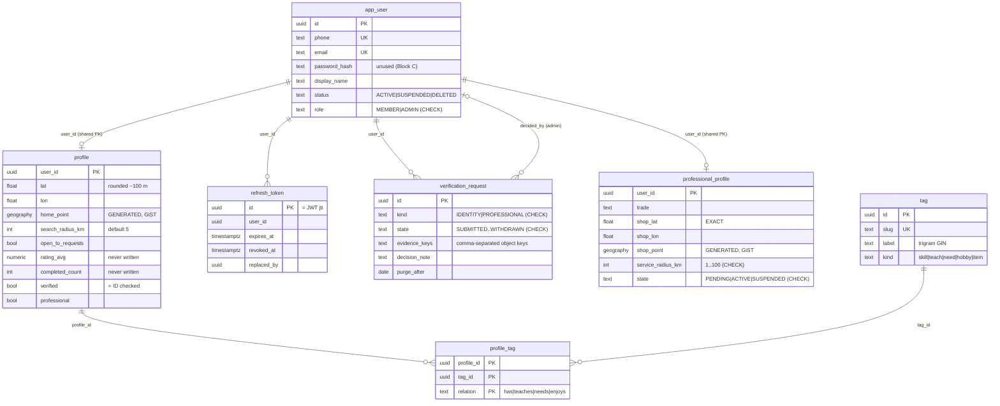
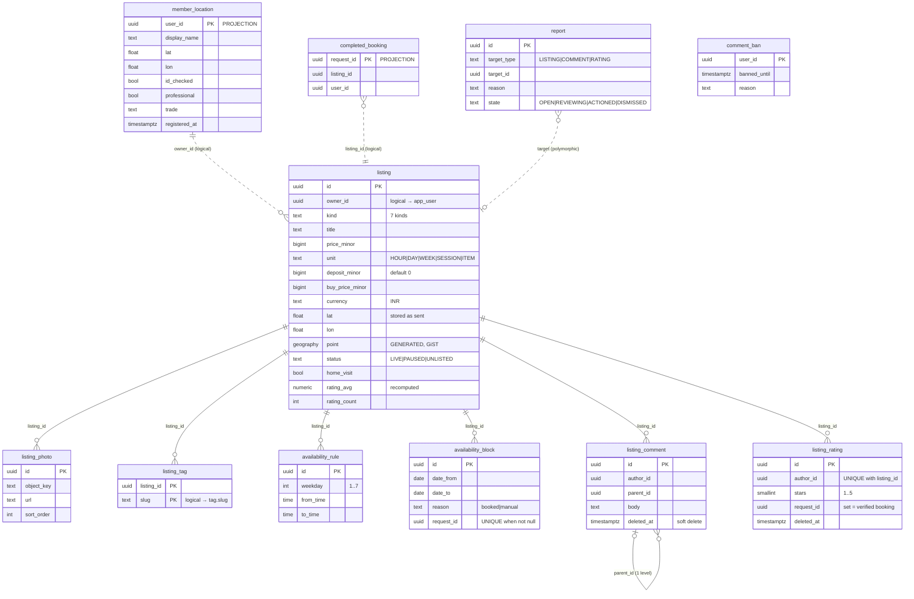
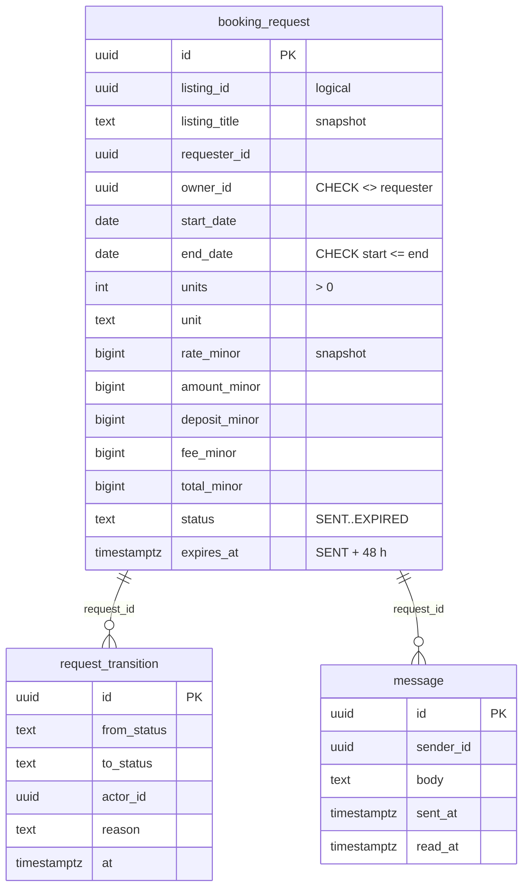

# 05 · Data model

> **Audience:** developers. Read from every `services/*/src/main/resources/db/migration/*.sql`
> and the JPA entities, 14 October 2026.
> **Rules:** `.claude/rules/database-migrations.md`. **Never edit an applied `V` file.** Add
> `V{n+1}__description.sql`.

## 1. Databases

One PostgreSQL 16 + PostGIS instance holds **six databases**, created by
`infra/db/init/01-databases.sql`. All use the `public` schema and, locally, the same `radius`
superuser. Isolation is by database, so **a service physically cannot join another service's
tables.**

| Database | Owner service | Extensions | Migrations |
| --- | --- | --- | --- |
| `radius_user` | user-service | postgis, pg_trgm | V1 init · V2 tag vocabulary · V3 verification & professionals · `R__dev_members` (dev profile only) |
| `radius_listing` | listing-service | postgis, pg_trgm | V1 init · V2 home visit & professionals · V3 currency INR · V4 comments, ratings, reports |
| `radius_search` | search-service | postgis, pg_trgm | V1 init · V2 currency INR |
| `radius_booking` | booking-service | postgis (unused) | V1 init · V2 currency INR |
| `radius_payment` | payment-service | — | V1 init · V2 currency INR |
| `radius_notification` | notification-service | — | V1 init |

## 2. Conventions every table follows

| Convention | Detail |
| --- | --- |
| Primary keys | `uuid`, generated **in Java** (`UUID.randomUUID()`) |
| Timestamps | `timestamptz NOT NULL DEFAULT now()`; Java uses `Instant`. Booking dates are `date` (`LocalDate`) |
| Money | `bigint` columns named `*_minor` (paise), plus `currency text NOT NULL DEFAULT 'INR'` |
| Fees | `int` basis points (`percent_bps`) |
| Location | `lat`/`lon double precision` + `geography(Point,4326)` **`GENERATED ALWAYS AS … STORED`** + **GiST** index. Hibernate maps only the two doubles; Postgres keeps the spatial column right |
| Full text | `tsvector` column kept by a `BEFORE INSERT OR UPDATE` trigger, **GIN** index |
| Enums | Stored as `text`. Only some have a `CHECK` (see [§11](#11-gaps-worth-knowing)) |
| Soft delete | `deleted_at` + `deleted_by` on anything moderation may need |
| Idempotency for money | A **unique constraint**, never a cache |
| Cross-service references | Plain `uuid` columns with **no FK** (the other row lives in another DB) |
| Outbox | Every producing service has `outbox_event` (see [§9](#9-outbox_event-shared-shape)) |

## 3. user-service: `radius_user`



Notable indexes and constraints:

- `app_user_contactable`: `phone IS NOT NULL OR email IS NOT NULL`.
- `refresh_token_user_idx` on `(user_id) WHERE revoked_at IS NULL`.
- `verification_one_open_per_kind`: **unique** `(user_id, kind) WHERE state IN ('SUBMITTED','IN_REVIEW')`.
- `verification_queue_idx (state, submitted_at)`.
- `professional_trade_idx (trade) WHERE state='ACTIVE'`.
- V2 seeds **26 tags** (`ON CONFLICT (slug) DO NOTHING`).

## 4. listing-service: `radius_listing`



Notable indexes and constraints:

- `listing_price_present`: `kind = 'OPEN_NEED' OR price_minor IS NOT NULL OR buy_price_minor IS NOT NULL`.
- `listing_point_gix` GiST, `listing_live_idx (kind, created_at DESC) WHERE status='LIVE'`,
  `listing_home_visit_idx WHERE status='LIVE'`.
- `availability_block_request_uidx`: **unique** `(request_id) WHERE request_id IS NOT NULL`,
  which makes a replayed `RequestAccepted` harmless.
- `listing_rating_one_per_author`: **unique** `(listing_id, author_id)`. It includes soft-deleted
  rows, which is why self-removal *restores* the row instead of inserting a new one.
- `report_one_per_reporter`: **unique** `(reporter_id, target_type, target_id)`.

## 5. search-service: `radius_search` (disposable read model)

| Table | Fed by | Key columns |
| --- | --- | --- |
| `listing_doc` | `ListingPublished` / `ListingUpdated` (upsert), `ListingUnlisted` (status), `ProfileUpdated` (owner name/photo/area) | `id` (= listing id), `owner_*`, `kind`, `title`, `description`, `tags text[]` (GIN), prices, `lat/lon/point` (GiST), `status`, `search_vector` (GIN) |
| `member_doc` | `ProfileUpdated` (upsert) | `user_id`, `display_name`, `tags text[]`, `radius_km`, `open_to_requests`, `lat/lon/point` (GiST), `search_vector` (GIN) |
| `saved_search` | API | `user_id`, `label`, `raw_query`, `parsed_json`, `radius_km`, `digest_frequency` (`daily/weekly/off`), `last_run_at` |

Full-text weighting (`'simple'` config):

- `listing_doc`: title **A**, tags **B**, description **C**, owner name **D**.
- `member_doc`: tags **A**, display name **B**, bio **C**.

**Rebuild procedure:** stop search-service, truncate `listing_doc` and `member_doc`, reset consumer
groups `search-service.listing` and `search-service.user` to earliest (Kafka UI or
`kafka-consumer-groups.sh --reset-offsets --to-earliest`), then start. This works only while the
topics still hold every event (default retention, single node). See [11](11-configuration-and-operations.md).

## 6. booking-service: `radius_booking`



Indexes: by requester, by owner, by `(listing_id, start_date)`, and
`booking_request_expiry_idx (expires_at) WHERE status='SENT'` for the expiry sweep.
`message_unread_idx (request_id, sender_id) WHERE read_at IS NULL`.

## 7. payment-service: `radius_payment`

| Table | Purpose | Key constraints |
| --- | --- | --- |
| `fee_config` | Fee per listing kind (`kind` NULL = default). `percent_bps`, `cap_minor`, `min_fee_minor`, `active_from`. **V1 seeds one all-zero default row** | `kind` unique |
| `payment` | One per accepted request. `payer_id`, `payee_id`, `amount/fee/deposit_minor`, `currency`, `state`, `gateway_ref` | **unique `request_id`**, unique `gateway_ref` |
| `deposit_hold` | Held deposit per request. `held_at`, `released_at`, `claim_state` | **unique `request_id`**. ⚠ no currency column |
| `payout` | Monthly roll-up per owner. `period` = `YYYY-MM`, `state` `PENDING/PAID/FAILED` | **unique `(owner_id, period)`** |
| `gateway_event` | Raw webhook log | **unique `gateway_ref`** (replay detection) |

There are no physical FKs in this database. Every relation is logical.

## 8. notification-service: `radius_notification`

| Table | Columns | Constraints |
| --- | --- | --- |
| `notification` | `user_id`, `kind`, `title`, `body`, `deep_link`, `channel` (`inbox/push/sms/email`), `state` (`NEW/SENT/READ/FAILED`), `event_id`, `read_at` | **unique `event_id` WHERE NOT NULL** (redelivery guard); `notification_unread_idx (user_id) WHERE read_at IS NULL` |
| `device_token` | `user_id`, `platform` (`ios/android/web`), `token` (unique), `last_seen` | No API writes it yet |

notification-service has **no outbox** (`radius.outbox.enabled: false`). It never publishes.

## 9. `outbox_event` (shared shape)

Created in each producing service's `V1__init.sql` (user, listing, search, booking, payment).

| Column | Type | Notes |
| --- | --- | --- |
| `id` | uuid PK | Sent as Kafka header `event-id`, which consumers use for idempotency |
| `topic` | text | e.g. `radius.request.v1` |
| `event_key` | text | Partition key, always the aggregate id |
| `event_type` | text | Record simple name, sent as header `event-type` |
| `payload` | text | JSON |
| `created_at` | timestamptz | |
| `published_at` | timestamptz | NULL until sent |
| `attempts` | int | Incremented on each failed send |

Index: `outbox_unpublished_idx (created_at) WHERE published_at IS NULL`. Published rows are
pruned after 7 days (daily at 03:15).

## 10. Projections at a glance

| Projection | DB | Source events | Idempotency |
| --- | --- | --- | --- |
| `member_location` | listing | `UserRegistered`, `ProfileUpdated`, `VerificationDecided`, `ProfessionalStatusChanged` | Redis guard on `event-id` + upsert by PK |
| `completed_booking` | listing | `RequestCompleted` | PK = `request_id` |
| `availability_block` (`booked`) | listing | `RequestAccepted` | partial unique `request_id` |
| `listing_doc` | search | `Listing*`, `ProfileUpdated` | `INSERT … ON CONFLICT DO UPDATE` |
| `member_doc` | search | `ProfileUpdated` | upsert |
| `payment`, `deposit_hold` (owned, event-created) | payment | `RequestAccepted` | unique `request_id` |
| `notification` (owned, event-created) | notification | `NotificationRequested`, `UserRegistered` | unique `event_id` |

## 11. Gaps worth knowing

- **Enums without a DB `CHECK`** (enforced only by Java): `listing.kind/unit/status`,
  `booking_request.status`, `payment.state`, `payout.state`, `deposit_hold.claim_state`,
  `tag.kind`, `profile_tag.relation`, `app_user.status`, `notification.channel/state`,
  `saved_search.digest_frequency`. Columns **with** a CHECK: `app_user.role`,
  `verification_request.kind/state`, `professional_profile.state`, `report.target_type/state`,
  `listing_rating.stars`.
- **Columns nothing writes:** `profile.rating_avg`, `profile.completed_count` (parked for a
  Kafka Streams job), `member_doc.bio`, `member_doc.rating_avg`, `listing_doc.owner_rating`.
  Listing events carry no `currency`, so `listing_doc.currency` is always the column default.
- **Listing coordinates are stored exactly as the client sends them.** Only the *guest* view is
  coarsened. Clients default a new listing to the member's (already rounded) home point, but the
  API does not enforce rounding.
- **Dev seed (`R__dev_members.sql`)** writes 4-decimal Berlin coordinates directly, bypassing
  `Geo` rounding.

## 12. Writing a migration

```sql
-- V5__favourite.sql
-- Why: Block E. A member can save a listing, not just a search. Lives in
-- listing-service because a favourite means nothing without its listing and
-- should disappear with it (ON DELETE CASCADE). One row per member per listing:
-- the primary key makes "favourite twice" a no-op instead of a duplicate.
CREATE TABLE favourite (
    user_id     uuid        NOT NULL,                 -- logical ref, no FK (other DB)
    listing_id  uuid        NOT NULL REFERENCES listing(id) ON DELETE CASCADE,
    created_at  timestamptz NOT NULL DEFAULT now(),
    PRIMARY KEY (user_id, listing_id)
);
CREATE INDEX favourite_listing_idx ON favourite (listing_id);
```

(An illustration only. Block E is not built.)

1. Next number in **that service's** folder. Numbering is per service.
2. Open with a `-- Why:` comment block.
3. Follow [§2](#2-conventions-every-table-follows).
4. Run `.\scripts\mvn-docker.ps1 -pl <service> -am test`, then start the service against a real
   DB. Flyway validates on boot (`ddl-auto: validate` fails fast if entity and schema disagree).
5. A hook (`.claude/hooks/protect-files.mjs`) blocks edits to tracked `V*.sql` files.
