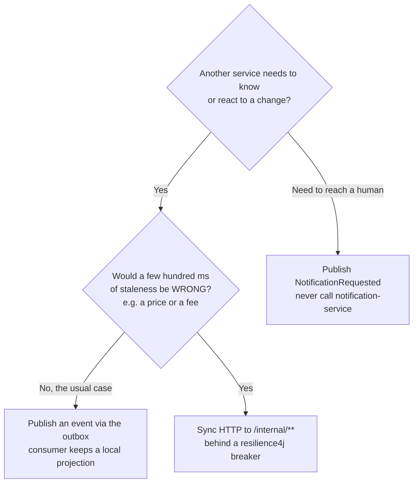
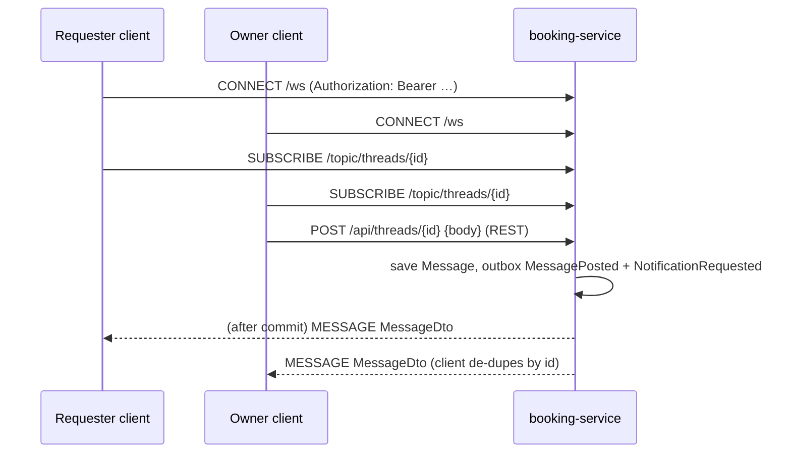

# 07 · Events and messaging

> **Audience:** backend developers. Read from `common/events/*`, `common/outbox/*`, every
> `@KafkaListener` and every `outbox.publish(...)`, 14 October 2026.
> **Rules:** `.claude/rules/events-and-messaging.md`. **Recipe:** the `add-event` skill in
> `.claude/skills/add-event/`.

## 1. When to use an event versus a call



There are exactly **three** sync calls in the system, all from booking-service. See
[§6](#6-synchronous-calls).

## 2. Topics

| Topic | Producer | Events |
| --- | --- | --- |
| `radius.user.v1` | user-service | `UserRegistered`, `ProfileUpdated`, `VerificationDecided`, `ProfessionalStatusChanged` |
| `radius.listing.v1` | listing-service | `ListingPublished`, `ListingUpdated`, `ListingUnlisted` |
| `radius.request.v1` | booking-service | `RequestCreated`, `RequestAccepted`, `RequestDeclined`, `RequestCompleted`, `RequestCancelled`, `MessagePosted` |
| `radius.payment.v1` | payment-service | `PaymentSettled`, `DepositReleased` |
| `radius.notification.v1` | user, booking, search | `NotificationRequested` |

- **Headers:** `event-type` (record simple name, used to route in the consumer) and `event-id`
  (outbox row UUID, used for idempotency).
- **Key:** always the aggregate id (`userId`, `listingId`, `requestId`; the recipient `userId`
  for notifications). Per-aggregate order is therefore kept within a partition.
- **Topic creation:** auto-created by the broker (`KAFKA_AUTO_CREATE_TOPICS_ENABLE=true`), which
  gives **1 partition** locally. Create topics explicitly before production.
- **Versioning:** event records change **additively only**. A breaking change publishes to
  `…v2` alongside `…v1` until every consumer has moved.

## 3. Event catalogue

All records live in `services/common/src/main/java/io/radius/common/events/RadiusEvents.java`.

### `radius.user.v1`

| Event | Fields | Published from |
| --- | --- | --- |
| `UserRegistered` | `userId, phone, displayName, at` | `AuthService.verifyOtp`, only when the account is new |
| `ProfileUpdated` | `userId, displayName, photoUrl, areaLabel, lat, lon, searchRadiusKm, openToRequests, tags[] (slugs), at` | `ProfileService.patch / addTag / removeTag` |
| `VerificationDecided` | `userId, kind, state, idChecked, checkedAt, at` | `VerificationService.approve / reject` |
| `ProfessionalStatusChanged` | `userId, trade, businessName, state, shopLat, shopLon, serviceRadiusKm, at` | `VerificationService.upsertProfessional / approve / suspend` |

### `radius.listing.v1`

| Event | Fields | Published from |
| --- | --- | --- |
| `ListingPublished` | `listingId, ownerId, kind, title, description, priceMinor, unit, depositMinor, buyPriceMinor, lat, lon, tags[], photoUrl, at` | `ListingService.create` (`photoUrl` is always null here) |
| `ListingUpdated` | same + `status` | `update`, `setStatus` (pause/resume), `attachPhoto` |
| `ListingUnlisted` | `listingId, ownerId, reason, at` | owner delete (`owner_unlisted`); moderator unlist (`moderated[: note]`) |

### `radius.request.v1`

| Event | Fields | Published from |
| --- | --- | --- |
| `RequestCreated` | `requestId, listingId, listingTitle, requesterId, ownerId, startDate, units, unit, amountMinor, depositMinor, at` | `RequestService.create` |
| `RequestAccepted` | `requestId, listingId, requesterId, ownerId, startDate, endDate, amountMinor, depositMinor, at` | `RequestService.accept` |
| `RequestDeclined` | `requestId, listingId, requesterId, ownerId, reason, at` | `RequestService.decline` |
| `RequestCompleted` | `requestId, listingId, requesterId, ownerId, amountMinor, depositMinor, at` | `RequestService.complete` |
| `RequestCancelled` | `requestId, listingId, requesterId, ownerId, cancelledBy, at` | `RequestService.cancel` |
| `MessagePosted` | `messageId, requestId, senderId, recipientId, preview (≤80 chars), at` | `ChatService.post` |

`start` (→ IN_PROGRESS) and the expiry sweep (→ EXPIRED) publish **no** request event. Expiry
sends only a notification.

### `radius.payment.v1`

| Event | Fields | Published from |
| --- | --- | --- |
| `PaymentSettled` | `paymentId, requestId, payerId, payeeId, amountMinor, feeMinor, state, at` | webhook `payment.settled` |
| `DepositReleased` | `requestId, payerId, amountMinor, at` | `releaseDeposit` |

### `radius.notification.v1`

| Event | Fields |
| --- | --- |
| `NotificationRequested` | `userId, channelHint ("push"), kind, title, body, deepLink, at` |

Producers: booking (request lifecycle and messages), user (verification outcomes), search
(daily digest). See [04 §8](04-domain-model.md#8-notifications-notification-service) for the kinds.

### Events nobody consumes yet

`RequestCreated`, `RequestDeclined`, `MessagePosted`, `PaymentSettled`, `DepositReleased`.
They exist for future consumers (trust numbers, analytics, statements). Removing them is a
breaking change.

## 4. Consumers

| Service | Group id | Topic | Handles | Effect | Idempotency |
| --- | --- | --- | --- | --- | --- |
| listing | `listing-service.user` | user.v1 | `UserRegistered` | `member_location.registered_at` (for `PostingLimiter`) | Redis `idem:listing.user:<event-id>` (3-day TTL) + upsert |
| | | | `ProfileUpdated` | upsert `member_location` | same |
| | | | `VerificationDecided` | `id_checked` | same |
| | | | `ProfessionalStatusChanged` | `professional`, `trade` | same |
| listing | `listing-service.request` | request.v1 | `RequestAccepted` | insert `availability_block` (`booked`) | unique `request_id` |
| | | | `RequestCompleted` | insert `completed_booking` | PK `request_id` |
| search | `search-service.listing` | listing.v1 | `ListingPublished/Updated/Unlisted` | upsert `listing_doc` / set status | `ON CONFLICT DO UPDATE` |
| search | `search-service.user` | user.v1 | `ProfileUpdated` | upsert `member_doc`, refresh owner fields on `listing_doc` | upsert |
| payment | `payment-service.request` | request.v1 | `RequestAccepted` | open `payment` + `deposit_hold` | unique `request_id` |
| | | | `RequestCompleted`, `RequestCancelled` | release the deposit | state check (`released_at`) |
| notification | `notification-service.fanin` | notification.v1 | `NotificationRequested` | inbox row + channels | unique `event_id` |
| notification | `notification-service.user` | user.v1 | `UserRegistered` | "Welcome to Radius" | unique `event_id` |

### Consumer template

```java
@KafkaListener(topics = Topics.REQUEST, groupId = "listing-service.request")
public void onRequestEvent(@Payload String payload,
                           @Header(name = Topics.HEADER_EVENT_TYPE, required = false) String type,
                           @Header(name = Topics.HEADER_EVENT_ID, required = false) String eventId) throws Exception {
    switch (type == null ? "" : type) {
        case "RequestAccepted" -> {
            var e = mapper.readValue(payload, RadiusEvents.RequestAccepted.class);
            listings.blockDates(e.listingId(), e.startDate(), e.endDate(), e.requestId()); // idempotent by unique key
        }
        default -> log.debug("ignoring {}", type);
    }
}
```

Rules:

- Group id is `<service>.<topic-short>`.
- Switch on the header and ignore unknown types. New event types must not break old consumers.
- Make the write itself idempotent: an upsert, a unique key, or an `exists` check. If you must
  use the Redis guard, **mark the key after the work succeeds**, not before. ⚠ The existing
  listing consumer marks it first; see [13](13-known-issues.md#events-and-data).

### Consumer settings

String deserialisers, `auto-offset-reset: earliest`, `enable-auto-commit: false`,
`ack-mode: record`. No custom error handler, so Spring Kafka's default applies: **10 attempts
with no back-off, then the record is logged and skipped**. There is **no dead-letter topic** yet
(backlog: `radius.dlq.v1`).

## 5. The transactional outbox

```mermaid
flowchart LR
    A[service method<br/>@Transactional] -->|1. business write| DB[(service DB)]
    A -->|2. outbox.publish topic,key,event| OB[(outbox_event)]
    DB -.same commit.- OB
    P[OutboxPublisher<br/>@Scheduled 500 ms] -->|3. SELECT … FOR UPDATE SKIP LOCKED<br/>ORDER BY created_at LIMIT 200| OB
    P -->|4. send + .get| K{{Kafka}}
    P -->|5. published_at = now| OB
    C[cleanup 03:15 daily] -->|delete published > 7 days| OB
```

| Aspect | Behaviour |
| --- | --- |
| Wiring | `RadiusOutboxAutoConfiguration` (on when `KafkaTemplate` is on the classpath and `radius.outbox.enabled` is not `false`). notification-service turns it off |
| Write | `OutboxService.publish(topic, key, event)` serialises with Spring's Jackson `ObjectMapper` (ISO dates). It must run **inside** the caller's transaction |
| Poll | Every `radius.outbox.interval-ms` (500), batch 200, `SKIP LOCKED` so replicas don't double-send |
| Send | `ProducerRecord(topic, key, json)` + headers; blocking `.get()`; producer `acks=all`, idempotent |
| Failure | `attempts++`, log, **stop the batch** (keeps order), retry next tick. ⚠ No maximum attempts or dead-letter |
| Guarantee | **At least once.** A crash after sending and before commit re-sends, which is why consumers must be idempotent |
| Prune | Published rows older than 7 days, daily at 03:15 (`radius.outbox.cleanup-cron`) |

**Never** inject `KafkaTemplate` into business code. A hook (`check-invariants.mjs`) flags
`kafka*.send(` anywhere except `OutboxPublisher.java`.

## 6. Synchronous calls

All in booking-service, `io.radius.booking.client`:

| Client | Call | Breaker | Fallback |
| --- | --- | --- | --- |
| `ListingClient.snapshot` | `GET {LISTING_SERVICE_URL}/internal/listings/{id}` | `listing` | **None.** The caller sees an error (currently 500). A missing listing → 404 |
| `ListingClient.isFree` | `GET …/internal/listings/{id}/free?from&to` | `listing` | `true`: booking's own overlap query is the real guard |
| `FeeClient.quote` | `GET {PAYMENT_SERVICE_URL}/internal/fees/quote?kind&amountMinor` | `payment` | `{feeMinor: 0, "Radius fee: none for now"}` |

resilience4j defaults (`booking-service/application.yml`): sliding window 20, failure threshold
50%, open 10 s, 3 calls half-open. A 3 s `timelimiter` is configured but has no effect (no
`@TimeLimiter`; the calls are synchronous), and no HTTP client timeouts are set.

## 7. Real-time channels

### Chat (STOMP over WebSocket, booking-service)



- Simple **in-memory** broker on `/topic`. Two replicas would not share subscribers.
- If the socket drops, clients still show the REST history; they reconnect every 4 s.

### Notification stream (SSE, notification-service)

`GET /api/notifications/stream` returns an `SseEmitter` (30 min timeout) held in memory per
instance. Each recorded notification is pushed as event `notification`. **No client uses it yet.**

### Delivery channels

`NotificationService.Channel` has `name()`, `supports(hint)` and `deliver(n)`. It is implemented
by `LoggingPush` (on) and `LoggingSms` (off) in `Channels.java`. Adding FCM is one class that
implements `Channel`. `device_token` is already in the schema.

## 8. Scheduled jobs

| Job | Schedule (property) | Where |
| --- | --- | --- |
| Outbox drain | every 500 ms (`radius.outbox.interval-ms`) | `common/outbox/OutboxPublisher` |
| Outbox cleanup | `0 15 3 * * *` (`radius.outbox.cleanup-cron`) | same |
| Expire `SENT` requests (48 h, 100 per run) | every 60 s (`radius.booking.expiry-interval-ms`) | `RequestService.expireStaleRequests` |
| Saved-search daily digest | `0 0 8 * * *` (`radius.search.digest-cron`) | `SavedSearchService.runDailyDigest` |

Crons use the JVM's time zone. None of them has a distributed lock yet.

## 9. Operating Kafka locally

- **Kafka UI:** <http://localhost:8090>: topics, messages (with headers), consumer groups, lag.
- **Replay a projection:** stop the consumer service, reset its group to earliest, restart
  (see [05 §5](05-data-model.md#5-search-service-radius_search-disposable-read-model)).
- **Stuck outbox:** `SELECT topic, event_type, attempts, created_at FROM outbox_event WHERE published_at IS NULL ORDER BY created_at LIMIT 20;`
  in the producing service's DB. The first row with a high `attempts` count is the blocker.

## 10. Adding an event: checklist

1. Add a `record` to `RadiusEvents.java` (additive. A new optional field is fine; renaming one is not).
2. Publish with `outbox.publish(Topics.X, aggregateId, new RadiusEvents.Y(...))` in the same
   `@Transactional` method as the state change.
3. In each consumer, add a `case "Y" ->` that is idempotent by construction.
4. If a human should hear about it, also publish `NotificationRequested`.
5. Unit-test the domain change. Exercise the path against the stack and watch it in Kafka UI.
6. Update this page's catalogue and consumer table in the same PR.
