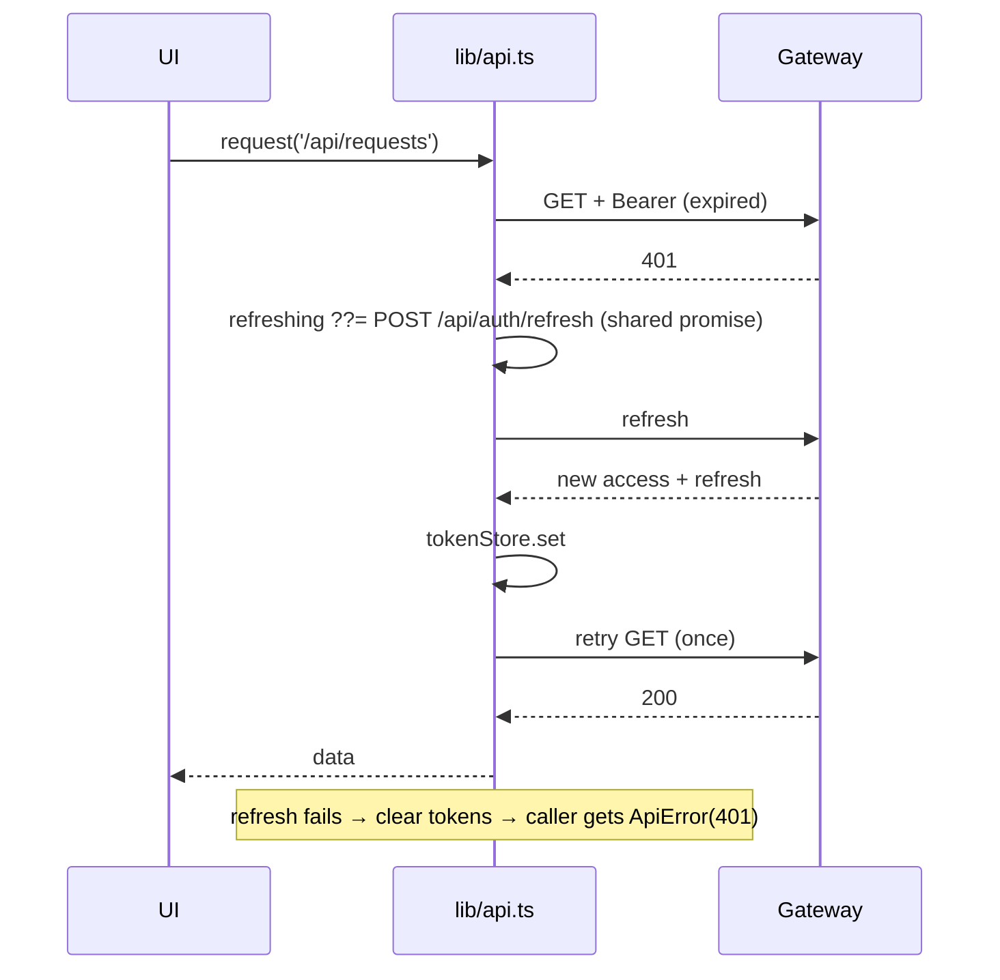

# 08 · Frontend: web and mobile

> **Audience:** client developers. Read from `apps/web` and `apps/mobile`, 14 October 2026.
> **Rules:** `.claude/rules/web-client.md`, `.claude/rules/mobile-client.md`.

## 1. Shared principles (both clients)

| Principle | What it means in code |
| --- | --- |
| **Gateway only** | Every call goes through `lib/api.ts` to the gateway base URL. No service ports |
| **Server owns money** | Render the `Breakdown` the server sends with `lib/format.ts`. Never add, multiply or apply a fee |
| **Branch on `code`** | Errors are `ApiError {status, code, message, fields}`. UI logic switches on `code` (`id_check_first`, `no_location`, …) |
| **One refresh at a time** | On a 401, all callers await one shared refresh promise, then retry once. Five parallel 401s must not rotate the token five times |
| **Browse as a guest** | Reading never needs sign-in. Only actions (request, comment, rate, report, list) gate, and sign-in returns to the same page |
| **Guests send coordinates** | `useViewerPoint` provides the member's home point, a stored guest point, or a fallback |
| **Honest copy** | "ID checked" and "Professional", never "verified" |
| **Parallel `lib/`** | `api.ts`, `auth.tsx`, `types.ts`, `format.ts`, `useThread.ts`, `useViewerPoint.ts` exist in both apps. **An API shape change usually needs both** |
| **Types are hand-maintained** | `lib/types.ts` mirrors the Java DTOs. If they disagree, `/v3/api-docs` is right |

## 2. Web app (`apps/web`)

**Stack:** Next.js 15 App Router · React 19 · TypeScript strict · TanStack Query 5 ·
`@stomp/stompjs` · hand-written CSS. Every page is `'use client'`.

### 2.1 Shell

```
app/layout.tsx       server component: metadata, manifest, <Providers><Nav/><main.shell>
app/providers.tsx    QueryClientProvider › ThemeProvider › AuthProvider
app/globals.css      the "Postcard" design tokens and every class
components/Nav.tsx   sticky top bar (desktop ≥860 px) + bottom tab bar (phone)
```

TanStack Query defaults: `staleTime 30 s`; 4xx never retried, 5xx and network errors up to 2
retries; `refetchOnWindowFocus: false`.

### 2.2 Routes

| Route | Access | Purpose | Main API calls |
| --- | --- | --- | --- |
| `/` | guest | Nearby feed: kind chips, radius 1–50 km, "use my location", photo mosaic, keyset "Show more" | `GET /api/feed` (infinite query) |
| `/search` | guest | **Ask** (sentence) or **Filter** (keyword, kinds); radius, sort; "what we understood" chips; neighbours + listings | `POST /api/search` |
| `/map` | guest | Tile-free radius map of hits, plus a list | `POST /api/search` (sort distance) |
| `/l/[id]` | guest; actions gated | Listing detail, badges, availability, owner card, booking sheet, ratings, comments, report | `GET /api/listings/:id` + components |
| `/u/[id]` | guest | Public member profile, tags by relation | `GET /api/users/:id` |
| `/pro/[id]` | guest | Professional shopfront + "What we checked" | `GET /api/professionals/:id` |
| `/sign-in` | guest | Phone → OTP (dev code auto-filled) → back to `?next=` | `POST /api/auth/otp`, `/verify` |
| `/new` | member | 3-step create: kind → details (price, deposit, home visit, photo, tags) → review | `GET /api/tags`, `POST /api/listings`, presign → PUT → attach |
| `/dashboard` | member | Stats, pending incoming requests, my listings with pause/resume | `GET /api/listings/mine`, `GET /api/requests?direction=in` |
| `/requests` | member | Incoming / outgoing tabs, polls every 30 s | `GET /api/requests` |
| `/requests/[id]` | member (party) | Breakdown, state-machine buttons, live chat, transition history | `GET /api/requests/:id`, `POST …/{accept,decline,start,complete,cancel}`, `useThread` |
| `/me` | member | Profile editor, home point, radius, tags, links to checks/pro/admin | `PATCH /api/me/profile`, tags |
| `/me/verification` | member | ID check → professional check, evidence upload, history, withdraw | `/api/me/verification` |
| `/me/professional` | member | Trade details, pin shop location | `PUT /api/me/professional` |
| `/admin` | admin | Tabs: **Checks** (verification queue) · **Reports** · **Restrictions** (bans) | `/api/admin/*`, `/api/moderation/*` |

### 2.3 Components

| Component | Role |
| --- | --- |
| `ListingTile` | Signature photo tile: image or deterministic gradient wash, scrim, kind, distance, price, badges. Sizes `lead`, `tall`, `wide` |
| `BookingSheet` | Modal: date (from tomorrow), units, message, blocked ranges, **server quote**, send |
| `CommentThread` | One-level Q&A; edit and delete per server-provided `canEdit`/`canDelete`; report |
| `Ratings` | Average, histogram, "verified booking" badge, rate / change / remove |
| `ReportControl` | Quiet "Report" link → reason + detail sheet |
| `RadiusMap` | Tile-free map (see [§2.6](#26-the-tile-free-map)) |
| `admin/ReportsQueue`, `admin/CommentBans` | Moderation surfaces |

### 2.4 `lib/`

| Module | What it does |
| --- | --- |
| `api.ts` | `BASE = NEXT_PUBLIC_API_URL ?? http://localhost:8080`. `tokenStore` (localStorage `radius.access`, `radius.refresh`). `request()` adds the bearer header, refreshes once on 401, throws `ApiError`. Namespaced helpers: `auth`, `me`, `users`, `tags`, `listings`, `comments`, `ratings`, `reports`, `moderation`, `search`, `requests`, `threads`, `verification`, `professionals`, `admin`, `notifications`. `uploadPhoto(file)` |
| `auth.tsx` | `AuthProvider`: `{me, loading, signedIn, isAdmin, setMe, signOut, refresh, requireSignIn(returnTo?)}`. `useRequireAuth()` redirects pages that cannot render for a guest |
| `types.ts` | DTO mirrors: `ListingKind`, `Unit`, `RequestStatus`, `Me`, `ListingCard`, `Listing`, `Breakdown`, `BookingRequest`, `SearchResponse`, `MapResponse`, verification and moderation types, `TRADES` |
| `format.ts` | `money()` (`en-IN`, ₹, lakh grouping), `rate()`, `distance()`, `KIND_LABEL`, `STATUS_TONE`, `when()`, `day()`, `initials()`. **Byte-identical on mobile** |
| `useThread.ts` | REST history + mark read, then a STOMP client: `brokerURL = baseUrl.replace(/^http/, 'ws') + '/ws'`, `Authorization` in CONNECT, reconnect 4 s, subscribe `/topic/threads/{id}`, de-dupe by id. Returns `{messages, live, send}` |
| `useViewerPoint.ts` | Member point → stored guest point (`radius.point`) → fallback **Kreuzberg 52.4996, 13.418** ("replace with your launch neighbourhood"). `locate()` runs only on a tap |
| `theme.tsx` | Light by default; dark via `data-theme="dark"` on `<html>`, stored in `radius.theme`. Deliberately **not** tied to `prefers-color-scheme` |

### 2.5 Design system: "Postcard"

Photo-first, magazine typography. **Bodoni Moda** for display text and prices, **Karla** for
everything you read. Near-square corners, hairline rules, almost no shadow. One warm accent.

| Token | Light | Dark |
| --- | --- | --- |
| `--bg` | `#fbfaf7` | `#12110f` |
| `--surface` / `--card` | `#ffffff` | `#1a1917` |
| `--ink` | `#131313` | `#f2efe9` |
| `--muted` | `#6e6a63` | `#9a958c` |
| `--rule` | `#e4e1da` | `#2b2825` |
| `--accent` | `#7a4b2a` | `#d09163` |
| `--ok` / `--danger` / `--warn` | `#2f4c3a` / `#8c2f2f` / `#7a5b18` | `#7fae8e` / `#d98b8b` / `#d8bb6a` |

Radii `--r-sm 2px`, `--r-md 4px`, `--r-lg 6px`, `--r-pill`. Spacing `--s1…--s7` = 4, 8, 12,
16, 22, 30, 44 px. Page width 1180 px. **Use tokens, never hard-coded colours.** Mobile mirrors
these in `apps/mobile/lib/theme.ts`.

> `design/_ds/` contains the **"Industry"** design system used by the design-canvas documents
> (build plan, prototype), **not** Postcard. Postcard is defined only in `globals.css` and
> `theme.ts`. The nine explored directions are in `design/directions/`.

### 2.6 The tile-free map

`RadiusMap` uses no map provider, no tiles, no key and no per-view cost. It is an equirectangular
projection centred on the viewer:

```
latSpan = radiusKm / 111.32 / zoom
lonSpan = latSpan / cos(lat)
x% = 50 + dx·50·0.78    y% = 50 − dy·50·0.78     (the radius ring sits at 78%)
```

Zoom runs 1–16 (×1.5 per step) with buttons, the wheel (non-passive, so the page does not
scroll) and pinch. Zoom resets when the radius changes. The legend reads
`N in view · M outside · X across`. Replacing it with MapLibre should keep the props.
⚠ Geometry caveats are in [13](13-known-issues.md#web).

## 3. Mobile app (`apps/mobile`)

**Stack:** Expo 52 · expo-router 4 · React Native 0.76.3 / React 18.3.1 (pinned) · TanStack
Query · expo-secure-store · expo-location · expo-image-picker · `@stomp/stompjs`.

### 3.1 Navigation

```
app/_layout.tsx            SafeArea › QueryClient › Theme › Auth › Stack
app/(tabs)/_layout.tsx     5 text-only tabs
  index.tsx    Nearby feed (FlatList, pull-to-refresh, infinite scroll)
  search.tsx   Ask / Filter
  new.tsx      List something (single page)
  requests.tsx Incoming / outgoing (polls 30 s)
  me.tsx       Profile + tags + My listings + sign out
app/sign-in.tsx, l/[id].tsx, requests/[id].tsx, u/[id].tsx, dashboard.tsx
components/ListingCardView.tsx
```

### 3.2 Differences from web

| Concern | Mobile |
| --- | --- |
| Token storage | **expo-secure-store** (Keychain / Keystore), never AsyncStorage. Access token also cached in memory |
| API URL | `EXPO_PUBLIC_API_URL` → else Android `extra.apiUrl` / `http://10.0.2.2:8080` (emulator alias for the host) → else `http://localhost:8080` (iOS simulator). On a real phone, set the LAN IP |
| STOMP | Adds `forceBinaryWSFrames` and `appendMissingNULLonIncoming` (the usual React Native workarounds) |
| Fonts | System fonts. Bodoni and Karla are not loaded |
| Images | `expo-image-picker` → fetch the local URI as a blob → presign → PUT |

### 3.3 Feature parity

| Feature | Web | Mobile |
| --- | --- | --- |
| Guest browsing | ✅ | ❌ Feed waits for sign-in; nothing links to sign-in |
| Nearby feed | ✅ radius chips, location | 🟡 radius from profile only |
| Search (ask / filter) | ✅ radius, sort, removable chips | 🟡 no location, radius or sort |
| Map | ✅ | ❌ (backlog: use `GET /api/search/map`) |
| Listing detail | ✅ full | 🟡 basic: no badges, availability, ratings, comments or report |
| Create listing | ✅ 3 steps, all units, home visit | 🟡 one page, 3 units, no home visit |
| Booking + quote | ✅ date picker, clash check | 🟡 typed date, no clash check |
| Request actions | ✅ incl. requester cancel | 🟡 no cancel |
| Chat | ✅ | ✅ |
| Comments / ratings / reports | ✅ | ❌ |
| ID check / professional | ✅ | ❌ |
| Admin | ✅ | ❌ (by design, web only) |
| Notifications UI | ❌ (API only) | ❌ (API only) |
| Dark mode | ✅ toggle | 🟡 provider exists, no toggle |

## 4. Auth flow (both clients)



This relies on the backend answering **401 (not 403)** for missing or expired tokens:
non-negotiable 9.

## 5. Adding a screen that needs new data

1. Backend endpoint first (the `add-endpoint` skill).
2. Add the DTO to `lib/types.ts` and a typed helper to `lib/api.ts`, **in both apps** if both
   will use it.
3. Use a TanStack Query hook with a stable key, e.g. `['listing', id]`. After a mutation,
   invalidate every key that reads the changed data (ratings invalidate both `['ratings', id]`
   and `['listing', id]`, because the average is denormalised).
4. Gate actions with `requireSignIn()`, not pages, unless the page means nothing to a guest
   (`useRequireAuth()`).
5. Format money and distance with `lib/format.ts` only.
6. `npm run typecheck` in each app you touched (web also `npm run lint`, once ESLint is set up).

## 6. Running the clients

```powershell
cd apps\web;    npm install; npm run dev          # http://localhost:3000
cd apps\mobile; npm install; npx expo start       # a = Android emulator, i = iOS simulator
```

Set `apps/web/.env.local` from `.env.example` (`NEXT_PUBLIC_API_URL=http://localhost:8080`).
Sign in with `+491700000001`. The OTP appears on screen in dev.
